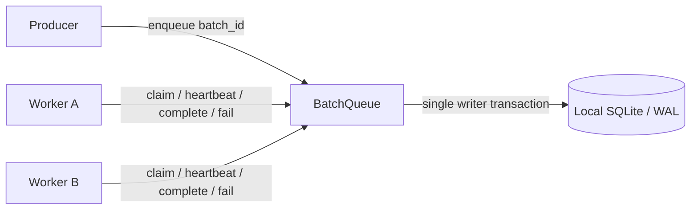
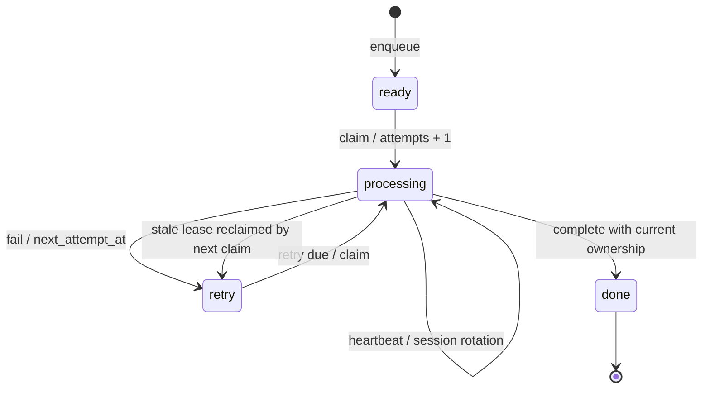

# Reliable Batch Queue

**把“任务被领走了”推进到“任务能恢复、旧进程不能误提交”。**

一个从实际批处理系统抽取的 Python / SQLite 队列核心。保留原子领取、心跳租约、失败重试、优先级与 FIFO 防饥饿策略，整理为可以独立运行和测试的脱敏工程示例。

`Python 3.10+` · `SQLite WAL` · `零运行时第三方依赖` · `14 项回归测试`

## 为什么做这个项目

长耗时数据任务从单 Worker 扩展到多 Worker 后，简单的 `SELECT → UPDATE` 会遇到几类问题：两个进程领到同一批次、Worker 崩溃后任务滞留、旧进程恢复后覆盖新进程的结果，以及低优先级批次长期得不到处理。

这个仓库把上述问题收敛到一个小型队列模块。面向小规模批处理、ETL 调度和异步任务交接，也适合阅读事务边界与故障恢复代码。

| 问题 | 实现 |
| --- | --- |
| 并发重复领取 | `BEGIN IMMEDIATE` 将租约回收、候选选择和状态变更放在同一事务 |
| Worker 中断 | 心跳更新时间；后续领取时回收过期任务 |
| 旧 Worker 误提交 | 所有状态更新同时匹配 `worker_id + claim_id + session_id` |
| 同一 Worker 重启 | 比较并交换（CAS）轮换会话，旧会话立即失效 |
| 临时错误 | `next_attempt_at` 控制延迟重试，`attempts` 记录领取次数 |
| 低优先级饥饿 | 达到等待阈值的可领取任务优先按 FIFO 排序 |
| 重复入队 | 唯一 `batch_id`；已完成任务也不会被重复入队重置 |

## 30 秒运行

需要 **Python 3.10 或以上**。下面的命令使用 Python 3.12；若本机 `python3` 已满足版本要求，可以替换命令名。

```bash
git clone https://github.com/2328956238/reliable-batch-queue.git
cd reliable-batch-queue

# 无需安装依赖，演示和测试均可离线运行。
PYTHONPATH=src python3.12 -m reliable_batch_queue.demo
PYTHONPATH=src python3.12 -m unittest discover -s tests -v
```

也可以安装到虚拟环境，使用命令行入口：

```bash
python3.12 -m venv .venv
source .venv/bin/activate
python -m pip install -e .
batch-queue-demo
python -m unittest discover -s tests -v
```

安装构建工具时可能访问包索引；程序运行只使用标准库。Windows 用户可以在安装后运行 `python -m reliable_batch_queue.demo`，无需设置 `PYTHONPATH`。

### 演示输出

```text
1. worker-a claimed batch-alpha; worker-b claimed batch-beta
2. worker-b completed batch-beta; worker-a stopped heartbeating
3. simulated +31 seconds: worker-b reclaimed batch-alpha (attempt=2)
4. stale worker-a heartbeat / complete / fail: all rejected
5. +10 seconds: retry succeeded; restarted session fenced its older session
6. final status: {'done': 2}
Temporary database removed. No network access or external services used.
```

演示使用两个 Worker 对象和可推进的时钟，按固定顺序复现故障，无需真的等待租约超时。并发回归测试另行启动 **4 个独立进程，竞争处理 80 个批次**，验证正常条件下每个批次只被领取一次。全部数据均为临时生成，运行结束清理数据库。

## 架构与状态机



Worker 可以是同一主机上的独立进程。跨主机使用时，应在数据库所在主机增加协调 API；本仓库提供队列库，不包含远程协议。



租约回收和下一次领取发生在同一事务中。Worker 只有持有当前 Claim，才能执行心跳、完成、失败或会话轮换。

## 最小使用示例

```python
from pathlib import Path
from tempfile import TemporaryDirectory
from uuid import uuid4

from reliable_batch_queue import BatchQueue

with TemporaryDirectory() as directory:
    queue = BatchQueue(Path(directory) / "queue.sqlite3", lease_seconds=60)
    queue.enqueue("example-batch-001", category="normal")

    # session_id 在每次 Worker 进程启动时生成；claim_id 由库生成。
    claim = queue.claim_next("worker-a", uuid4().hex)
    if claim is not None:
        # 执行业务处理；长任务应周期性 refresh_lease(claim)。
        completed = queue.complete(claim)
        print(completed, queue.status_counts())
```

`complete()`、`fail()`、`refresh_lease()` 返回 `False` 表示 Claim 已失去所有权或任务不处于处理中。此时 Worker 应停止提交结果。业务处理失败时可调用：

```python
queue.fail(claim, "temporary downstream failure", retry_delay_seconds=30)
```

重启恢复时，调用方需要先安全保存旧 Claim，再用新会话 ID 调用 `resume_lease(old_claim, new_session_id)`。它返回新 Claim 或 `None`，同一旧会话只能成功轮换一次。

| API | 返回值 | 用途 |
| --- | --- | --- |
| `enqueue(batch_id, category="normal")` | `bool` | 新 ID 入队；重复 ID 返回 `False` |
| `claim_next(worker_id, session_id, priority_order=...)` | `Claim` / `None` | 原子领取；空优先级元组 `()` 使用严格 FIFO |
| `refresh_lease(claim)` | `bool` | 当前 Claim 心跳 |
| `resume_lease(claim, new_session_id)` | `Claim` / `None` | CAS 轮换会话 |
| `complete(claim)` | `bool` | 当前 Claim 完成确认 |
| `fail(claim, error, retry_delay_seconds=300)` | `bool` | 当前 Claim 延迟重试 |
| `get(batch_id)` / `status_counts()` | `dict` / `None` | 查看状态 |

## 调度细节

1. 先筛选 `ready` 或已到重试时间的 `retry`。
2. 已达到 `starvation_seconds` 的任务放在最前面，按创建时间、插入顺序 FIFO。
3. 其余任务按 `priority_order` 的分类顺序排列，同类按创建时间、插入顺序 FIFO。
4. 未列出的分类排在已知分类之后；空优先级元组代表严格 FIFO。

默认优先级是 `urgent → normal → bulk`，默认 aging 阈值为 36 小时。等待时间按首次入队时间计算；aging 不会让尚未到重试时间的任务提前领取。防饥饿策略不构成等待时间上限保证，实际吞吐仍取决于 Worker 容量与积压。

## 回归测试

测试直接针对故障与竞争条件，使用临时目录和可控时钟：

| 测试范围 | 核心断言 |
| --- | --- |
| 并发事务 | 4 进程、80 批次，领取不重复，全部完成且每批 attempts=1 |
| 过期回收 | 新 Worker 重新领取后，旧 Worker 的全部写操作被拒 |
| 心跳 | 最近心跳有效时，其他 Worker 不能重新领取 |
| 所有权 | Worker、Claim、Session 任意一项不匹配均拒绝更新 |
| 重启竞争 | CAS 轮换后，旧会话和竞态重启请求不能覆盖当前会话 |
| 重试 | 重试时间前不可领取，到期可领取且次数递增 |
| 公平性 | 老任务优先、同时间戳 FIFO、空优先级 FIFO |
| 持久化与输入 | 重开数据库保留状态；重复入队不重置；参数校验与 SQL 参数绑定 |

GitHub Actions 配置了 Python 3.10 / 3.12 / 3.13 矩阵，运行完整测试及演示。仓库初版已在 Python 3.12 本地验证 14 项测试通过；远端 CI 以实际运行结果为准。

## 工程边界

- **执行可能重复。** Worker 完成业务写入后、确认队列前崩溃，会造成再次处理。业务层应通过唯一业务键、结果去重或事务设计保证副作用幂等；队列的 fencing 只保护自身状态，不能撤回已经发生的外部写入。
- **租约采用软过期。** 超时使任务可以被回收，但不会自动中止旧进程。在被回收前，原 Claim 仍可心跳或完成；被新 Claim 替换后立即失效。精确超时边界沿用严格小于判断。
- **SQLite 是单主机存储。** 使用 WAL 并串行化写事务，不提供跨主机数据库高可用，也不应把数据库直接放到共享网络盘。`synchronous=NORMAL` 的断电持久性与更强同步级别不同，突然掉电可能丢失最近提交。
- **时间和策略需要一致。** 同库实例应使用相同租约设置和协调主机时钟；系统时钟跳变可能影响租约与重试调度。
- **刻意保持小范围。** 不包含鉴权 API、任务负载存储、后台回收线程、最大重试次数、死信队列或外部业务处理流程。共享数据库的调用者视为可信，Claim token 是所有权校验机制而非访问控制系统。

## 代码来源与抽取调整

核心事务、字段与调度算法来自既有批处理队列实现 `crawl_batch_store.py`。发布版本将目录标识改为通用 `batch_id`，把全局数据库配置封装为显式 `BatchQueue` 实例，移除历史数据库迁移、部署配置和业务处理逻辑。

同时收紧展示库的 API：完成和失败必须携带完整 Claim；会话恢复增加旧会话比较；空优先级可正确运行；相同时间戳补充稳定 FIFO；连接在操作结束后显式关闭。仓库内只包含通用代码和合成测试数据。

```text
src/reliable_batch_queue/
  queue.py                 # 原子队列与租约状态机
  demo.py                  # 两 Worker 故障恢复演示
tests/test_queue.py        # 回归与多进程竞争测试
.github/workflows/tests.yml
pyproject.toml
```
