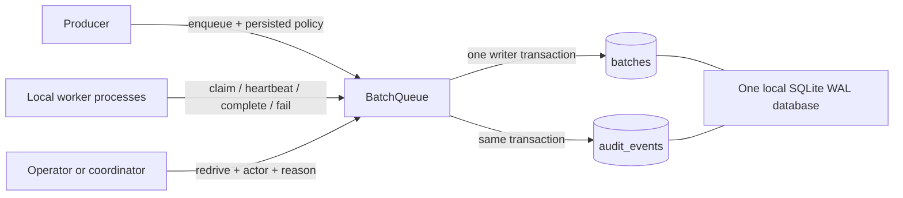
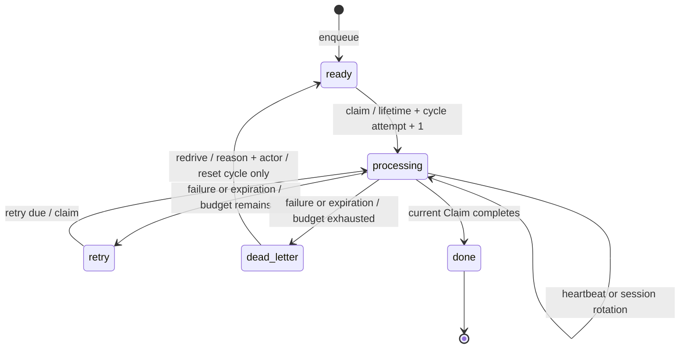

# Reliable Batch Queue

**面向批处理与 ETL 的可靠任务调度核心：租约恢复、有限重试、死信重放和事务审计。**

从实际批处理系统抽取的 Python / SQLite 脱敏工程示例。处理多 Worker 争抢、进程中断、旧进程误提交和持续失败任务无法收敛的问题；可在单机离线复现完整故障处理流程。

`Python 3.10+` · `SQLite WAL` · `零运行时第三方依赖`

> **版本来源：** 原子领取、租约 fencing、会话轮换和优先级/aging 来自既有批处理实践。**2026-10-14 在脱敏展示版新增**持久化重试策略、死信、人工重放、事务审计及旧库迁移；这些新增功能仅完成本地验证，**不代表已经部署到生产**。仓库测试规模是合成验证条件，不是业务吞吐或业务收益。

## 解决的问题

| 故障或约束 | 机制 | 能保证什么 |
| --- | --- | --- |
| 两个 Worker 同时领取 | `BEGIN IMMEDIATE` 内回收、选择、更新 | 同一时刻队列只有一个有效 Claim |
| Worker 崩溃/失联 | 心跳租约，下一次领取时回收 | 任务可重新进入调度 |
| 旧 Worker 迟到提交 | 同时匹配 `worker_id + claim_id + session_id` | 旧 Claim 不能改写当前队列状态 |
| 下游持续不可用 | 每任务持久化预算及封顶指数退避 | 失败次数有限，避免无休止循环 |
| 超时被反复立即重领 | 租约过期与显式失败共用预算/退避 | 崩溃也会耗尽预算并进入死信 |
| 排障后需要重试 | 只允许从死信人工 `redrive`，必填操作者与原因 | 恢复处理且保留历史尝试 |
| 状态改了但日志没写 | 状态和审计事件同一数据库事务 | 成功状态与对应事件一起提交或一起回滚 |
| 低优先级饥饿 | 优先级 + aging + 稳定 FIFO | 已等待足够久且已到期的任务优先 |

## 离线运行

需要 **Python 3.10+**。如果系统 `python3` 版本过旧，请使用已安装的新版本；以下以 Python 3.12 为例。

```bash
git clone https://github.com/2328956238/reliable-batch-queue.git
cd reliable-batch-queue
PYTHONPATH=src python3.12 -m reliable_batch_queue.demo
PYTHONPATH=src python3.12 -m unittest discover -s tests -v
```

Windows 可以在虚拟环境中 `python -m pip install -e .` 后运行 `python -m reliable_batch_queue.demo` 和测试。安装构建工具可能访问包索引；演示和队列库本身只使用标准库。

演示使用临时数据库、两个 Worker 对象和可推进时钟，不访问网络、不等待真实超时，结束后清理数据库：

```text
1. worker-a claimed batch-alpha; worker-b claimed batch-beta
2. worker-b completed batch-beta; worker-a stopped heartbeating
3. +31s: expired attempt 1 scheduled with 10s backoff
4. +10s: worker-b claimed attempt 2; stale worker-a writes rejected
5. attempt 2 failed: exponential backoff capped at 15s
6. attempt 3 expired: budget exhausted; moved to dead_letter
7. reasoned redrive completed attempt 4 (new cycle=1); old session fenced
8. audit trail: retry_scheduled -> retry_scheduled -> dead_lettered -> redriven -> completed
9. final status: {'done': 2}
Temporary database removed. No network access or external services used.
```

## 架构与状态机





一个 Claim 对应一次尝试，在**领取时**消耗预算；失败与过期不额外累加。因此同一次尝试不会因“失败 + 过期”重复计数。`max_attempts` 包括第一次领取；到预算最后一次仍可正常完成，只有失败或过期才进入死信。

## 最小使用示例

```python
from pathlib import Path
from tempfile import TemporaryDirectory
from uuid import uuid4

from reliable_batch_queue import BatchQueue, RetryPolicy

with TemporaryDirectory() as directory:
    queue = BatchQueue(
        Path(directory) / "queue.sqlite3",
        lease_seconds=60,
        retry_policy=RetryPolicy(max_attempts=4, base_delay_seconds=10, max_delay_seconds=25),
    )
    queue.enqueue("example-batch-001", category="normal")
    claim = queue.claim_next("worker-a", uuid4().hex)
    if claim:
        # 假设这次业务处理失败；首次失败延迟 10 秒后才可重试。
        queue.fail(claim, "downstream temporarily unavailable")
    print(queue.get("example-batch-001"))
    print(queue.events("example-batch-001"))
```

默认策略是最多 5 次尝试，基础延迟 300 秒，延迟上限 3600 秒：

`delay = min(max_delay_seconds, base_delay_seconds × 2^(cycle_attempts - 1))`

策略可在队列构造时指定，也可通过 `enqueue(..., retry_policy=RetryPolicy(...))` 为任务单独指定。它随任务落库；重开实例更改默认配置、重复入队，都不会修改已有任务预算。`base_delay_seconds=0` 可明确选择立即重试，但仍受最大次数约束。

旧接口仍支持 `fail(claim, error, retry_delay_seconds=30)`：显式参数覆盖**本次**延迟，即使超过策略上限，也按调用者指定的值执行；它不能绕过次数预算。不传该参数时使用持久化策略。默认首次失败仍延迟 300 秒，后续失败会指数增长；过期回收也采用退避，不再默认立即重领。

## API

| API | 返回值 | 说明 |
| --- | --- | --- |
| `enqueue(batch_id, category="normal", retry_policy=None)` | `bool` | 新 ID 入队；任何已有状态均不被重复入队重置 |
| `claim_next(worker_id, session_id, priority_order=...)` | `Claim` / `None` | 原子回收过期租约并领取一个到期任务 |
| `refresh_lease(claim)` | `bool` | 当前 Claim 心跳 |
| `resume_lease(claim, new_session_id)` | `Claim` / `None` | CAS 轮换会话；需要调用者安全保存旧 Claim |
| `complete(claim)` | `bool` | 当前 Claim 完成确认 |
| `fail(claim, error, retry_delay_seconds=None)` | `bool` | 重试或转入死信 |
| `redrive(batch_id, actor=..., reason=...)` | `bool` | 仅恢复死信；重复点击/并发重放只有一个成功 |
| `events(batch_id=None, after_event_id=0, limit=100)` | `list[dict]` | 顺序查询审计事件，支持全局事件 ID 游标，单页最多 1000 条 |
| `get(batch_id)` / `status_counts()` | `dict` / `None` | 查询持久化状态、策略与计数 |

`complete()`、`fail()`、`refresh_lease()` 返回 `False` 表示当前 Claim 已失去所有权或任务不处于处理中。Worker 应停止使用该 Claim 提交结果。被拒绝的调用不会写入状态变更审计；鉴权失败/滥用检测日志属于调用方职责。

死信重放示例：

```python
# 先修复失败原因，再由可信操作入口执行；库本身没有用户鉴权。
queue.redrive("example-batch-001", actor="operator-a", reason="已修复下游字段映射")

# 全局游标分页。每次处理成功后由消费方保存最后一个 event_id。
page = queue.events(after_event_id=0, limit=100)
if page:
    next_cursor = page[-1]["event_id"]
```

`attempts` 和 `Claim.attempt` 是历史总领取次数；`cycle_attempts` 是自入队或最近重放以来的领取次数。重放只把后者归零，不修改历史审计、不换原重试策略，也保留最后错误供排查；任务完成后清空当前错误，历史事件仍可查。事件含领取次数、Claim/Session、操作者、原因和结构化状态信息；会话轮换事件记录旧 Session 及新 Session。

## 公平性与兼容迁移

先筛选 `ready` 或已到期 `retry`；达到 `starvation_seconds` 的任务按创建时间、插入顺序 FIFO，其余按分类优先级、创建时间、插入顺序排序。默认分类是 `urgent → normal → bulk`，默认 aging 为 36 小时，空优先级元组 `()` 表示严格 FIFO。未到重试时间的任务不会因 aging 提前执行。

重放保留原创建时间，因此老任务重放后可能获得 aging 优先。这让故障修复后的积压先恢复，但不适合允许无限人工重放的滥用场景；重放频率应在上层控制。公平性不保证固定等待时长，仍取决于 Worker 容量。

**兼容本仓库 0.1.0 旧 schema。** 首次打开时使用一个写事务重建状态 CHECK 约束、补充重试字段并建立审计表；保留原 `rowid`、创建时间、Claim、Session、重试到期时间与状态。旧 `attempts` 同时初始化为历史和当前周期次数，预算初始化为 `max(新默认预算, 已有次数 + 1)`，给历史任务至少一次剩余领取机会。每条旧记录写入 `legacy_imported` 基线事件，明确迁移前没有事件明细，之后重开不会重复导入。

升级前应停止旧版本进程并备份数据库；不要让 0.1.0 与 0.2.0 同时访问同一个库，因为旧代码不了解死信预算。迁移不支持无损降级或任意外部表结构；回滚使用升级前备份。本仓库未对生产数据库执行迁移。

## 验证

2026-10-14 在 **Python 3.12.14** 本地运行 29 项测试通过，离线演示通过。GitHub Actions 配置 Python 3.10 / 3.12 / 3.13；远端 CI 状态以 GitHub 实际运行结果为准。

| 验证场景 | 核心断言 |
| --- | --- |
| 独立进程争抢 | 4 进程处理 80 个合成批次，无重复领取，全部完成 |
| 超时 + 显式失败混合 | 同一预算；到期前不能领取；最后尝试超时直接进入死信 |
| 重放竞争 | 4 进程同时重放，仅一个成功，仅一条重放事件 |
| 过期竞争 | 4 进程争抢已耗尽预算的过期任务，零次新领取，仅一条死信事件 |
| fencing | Worker/Claim/Session 任一不匹配拒绝更新；重放后旧 Claim 仍不能提交 |
| 审计写入故障 | 用 SQLite trigger 注入失败；入队、失败、过期回收、重放均回滚状态 |
| 数据库迁移 | 保留 FIFO/所有权/历史次数；中途故障回滚旧表；重开不重复导入 |
| 策略与调度边界 | 封顶指数退避、准确到期、次数=1、显式延迟、策略持久化、aging/FIFO |

这些是正确性验证，不是吞吐基准。设计讨论和面试说明见 [可靠性设计](docs/reliability-design.md)。

## 工程边界

- **执行语义是至少一次。** 业务写入成功后、队列确认前崩溃，仍可能重复处理。业务侧必须通过业务唯一键、结果去重或事务设计处理幂等；fencing 只保护此队列数据库，不能撤回外部副作用。
- **软过期与惰性回收。** 精确边界采用 `claimed_at < now - lease_seconds`；在下一次 `claim_next` 回收前，原 Claim 仍可心跳或完成。没有后台扫描器，因此无人领取时过期任务不会主动转移。
- **单机存储。** SQLite WAL 只有一个写者；回收和审计增加写事务工作量，当前会扫描所有到期租约，不能当成大规模分布式队列。跨主机 Worker 应访问数据库所在主机的协调 API，本仓库不提供该 API、网络盘共享或高可用。
- **退避未加抖动。** 固定退避便于离线复现；大量同时失败任务可能同时重试。随机抖动、分批回收、限流、告警、指标和审计保留策略是进一步扩展点。
- **审计不是防篡改账本。** 状态和事件同库事务保证提交一致性；有直接数据库写权限的人仍可修改记录，库没有鉴权。心跳也写审计，长期运行需要上层制定保留策略；原因/错误最多保存 1000 字符，应避免写入密钥和业务敏感数据。
- **时间与落盘。** 同库实例应采用一致租约设置和主机时钟；系统时间跳变影响调度。`synchronous=NORMAL` 在突然掉电时可能丢失最近提交，不能等同于最强落盘保证。

## 目录

```text
src/reliable_batch_queue/
  queue.py                    # 状态机、迁移、事务审计
  demo.py                     # 离线故障、死信与重放演示
tests/
  test_queue.py               # 原始领取、fencing、FIFO/aging 与多进程验证
  test_retry_lifecycle.py     # 重试预算、审计故障、竞争与迁移验证
docs/reliability-design.md
.github/workflows/tests.yml
```
